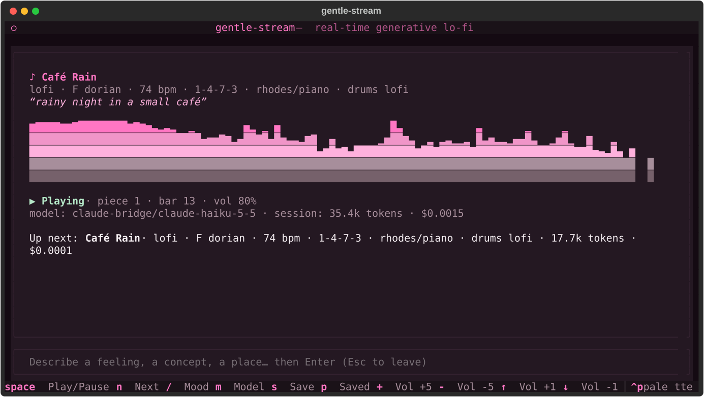
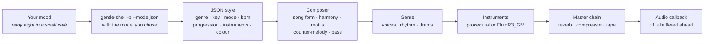

<!-- markdownlint-disable-next-line MD041 -->
<a id="top"></a>

<div align="center">

<h1>gentle-stream</h1>

<p><strong>Endless generative music in your terminal, steered by how you feel.</strong></p>

<p>


<a href="LICENSE"></a>
</p>

<p>
<a href="https://gentlemanprogramming.com/"><strong>Website</strong></a> &bull;
<a href="https://www.youtube.com/@GentlemanProgramming"><strong>YouTube</strong></a> &bull;
<a href="https://github.com/Gentleman-Programming/gentle-stream"><strong>GitHub</strong></a>
</p>

<br/>

<p>
Type <em>"rainy night in a small café"</em> and the music turns into it at the next bar, without stopping.
<a href="https://github.com/Gentleman-Programming/gentle-shell">Gentle Shell</a> reads your mood with the model you
pick, and gentle-stream composes and synthesizes the rest live, bar by bar.
<strong>It never ends, it never repeats exactly, and every note is newly composed.</strong>
</p>



</div>

<div align="center"></div>

## Features

---

### Moods, not settings — Say how it should feel

Describe a feeling, a concept, a place or a scene, in any language. Gentle Shell turns it into musical parameters (genre, key, mode, tempo, progression, instruments, energy, brightness, swing, vinyl, space, melody density) with **the model you choose**. The new style starts at the next bar while the current one keeps playing. A request takes a few seconds; if it fails, the status line says so and the music is untouched.

---

### Real composition — Not a loop

A composer plans every piece with a **song form** (intro → A → B → A' → breakdown → B' → release, then the form loops with fresh variation), cadences that resolve, passing chords, an occasional key lift, a **motif** developed by repetition, sequence, inversion and augmentation, a counter-melody in contrary motion and a bass line that walks into the next chord. Press `n` and you get a new piece with the same mood: new key, progression, melody and groove.

---

### Six genres — Lo-fi by default

Lo-fi, ambient, chiptune, synthwave, jazz, rock/metal, electro, electro house, cumbia and dubstep. The model picks the genre from your mood, or you name it (*"jazz for a rainy night"*). Each genre has its own voices, rhythmic treatment, drum patterns and master chain, and they all share the same composer. See [Genres](#genres).

---

### Procedural or sampled — Your choice, no setup required

Every instrument is synthesized out of the box. Run `gentle-stream setup-samples` once and the tonal voices and drums switch to the **FluidR3_GM** soundfont (MIT), rendered note by note with FluidSynth. If anything is missing, it falls back to the procedural instruments. See [Sampled instruments](#sampled-instruments).

---

### Seamless, real-time audio — No clicks, no gaps

The engine renders one bar at a time, with note tails ringing into the next bar, and runs the result through a stateful master chain (vinyl, room, convolution reverb, tape wow, tone, bus compressor, tape saturation), so bars join seamlessly. A producer thread stays about one second ahead; the audio callback only copies samples. Pause, volume and `n` all fade or crossfade.

---

### Saved prompts — Keep what you love

Press `s` to save what is playing under a name. gentle-stream stores the prompt **and the musical parameters it produced**, so pressing `p` later brings that sound back instantly, with no model call. Every piece is still newly generated.

---

### Token-aware — You see what each mood costs

Only describing a mood calls a model. The status line shows what that call used, and the model line keeps a running total for the session. Everything else costs zero tokens. See [Token usage](#token-usage).

<div align="right"><a href="#top">Back to top</a></div>

<div align="center"></div>

## Get started

**Requirements**

| You need | Why |
| :--- | :--- |
| [uv](https://docs.astral.sh/uv/) | Installs and runs gentle-stream (Python 3.13) |
| [Gentle Shell](https://github.com/Gentleman-Programming/gentle-shell) | `gentle-shell` on your `PATH`, with at least one signed-in model provider; it interprets your moods |
| An audio output device | Playback goes through PortAudio (`sounddevice`); on Linux install your distro's PortAudio package (for example `libportaudio2`) |
| FluidSynth *(optional)* | Only for sampled instruments: `brew install fluid-synth` or your system's `fluidsynth` package |

**Install as a command**

```bash
uv tool install 'gentle-stream[samples] @ git+https://github.com/Gentleman-Programming/gentle-stream'
gentle-stream
```

**Or run from a clone**

```bash
git clone https://github.com/Gentleman-Programming/gentle-stream
cd gentle-stream
uv run gentle-stream
```

It starts playing right away. Press `/`, describe a mood, press `Enter`.

```bash
gentle-stream --mood "rainy night in a small café"        # interpret a mood on start
gentle-stream --model claude-bridge/claude-haiku-5-5      # choose the model up front
gentle-stream setup-samples                               # optional: sampled instruments (~120 MB, once)
gentle-stream --help                                      # every flag and key
```

<div align="right"><a href="#top">Back to top</a></div>

<div align="center"></div>

## How it works



| Stage | Module | What happens |
| :--- | :--- | :--- |
| **Mood** | `bridge.py` | Runs `gentle-shell -- -p --mode json --no-session -nt -ns -np -nc --no-mcp --no-themes --no-skill-registry --thinking off [--model …] "<prompt>"`, reads the answer and token usage from the final assistant `message_end` event, and extracts one JSON object |
| **Style** | `style.py` | Validates and clamps every field (`name`, `genre`, `key`, `mode`, `bpm`, `progression`, `chords`, `lead`, `drums`, `energy`, `brightness`, `swing`, `vinyl`, `space`, `lead_density`); anything missing or invalid keeps the current value |
| **Composer** | `composer.py` | Decides **what** plays in each bar: section, energy, chord, key lift, active layers, and the notes of the lead, counter-melody and bass. Pure and deterministic per seed |
| **Genre** | `genres/` | Decides **how** it sounds: voices, chord rhythm (sustained, comped, arpeggiated, strummed…), drum patterns and master settings |
| **Instruments** | `genres/*.py`, `synth.py`, `samples.py` | Procedural oscillators, envelopes and filters, or FluidR3_GM notes rendered offline by FluidSynth and level-matched to the procedural voices |
| **Engine** | `engine.py`, `mastering.py` | Mixes each bar into a buffer whose tails ring into later bars, then applies the stateful master chain: vinyl, room, procedural-IR convolution reverb, tape wow, tone, RMS bus compressor, tape saturation |
| **Player** | `player.py` | A producer thread keeps about one second of audio queued; the audio callback only copies samples, applies a smoothed gain and feeds the spectrum. The screen shows the bar you are **hearing**, not the one being rendered |
| **TUI** | `app.py` | A Textual app in the gentlemanprogramming.com palette (a `gentleman` theme: rose and pink on deep plum) |

Model extensions stay enabled on purpose: some providers (such as `claude-bridge`) are extensions.

<div align="right"><a href="#top">Back to top</a></div>

<div align="center"></div>

## Controls

| Key | Action |
| :--- | :--- |
| `space` | Play / pause (smooth fade, no clicks) |
| `n` | Next piece with the same mood: new key, progression, melody and groove |
| `/` | Describe a mood; `Enter` sends it, `Esc` leaves the input |
| `m` | Choose the model Gentle Shell uses (listed from `gentle-shell -- --list-models`); `Enter` picks, `Esc` keeps the current one |
| `s` | Save what is playing under a name; `Enter` saves (an existing name is replaced), `Esc` cancels |
| `p` | Saved prompts: `Enter` applies one instantly, `d` or `Delete` removes it, `Esc` closes |
| `+` / `-` | Volume up / down by 5% |
| `↑` / `↓` | Volume up / down by 1% |
| `q` | Quit (a running `gentle-shell` call is cancelled) |

### Flags

| Flag | Meaning |
| :--- | :--- |
| `--model provider/id` | Model Gentle Shell uses to interpret moods (default: Gentle Shell's default) |
| `--mood TEXT` | Mood to interpret as soon as the app starts |
| `--gentle-shell PATH` | `gentle-shell` executable to run (default: `gentle-shell`) |
| `setup-samples` | Subcommand: download the FluidR3_GM soundfont once (see below) |

<div align="right"><a href="#top">Back to top</a></div>

<div align="center"></div>

## Token usage

After each interpretation the status line shows what that call used, and the model line keeps the session total:

```text
Up next: Café Rain · lofi · F dorian · 74 bpm · 1-4-7-3 · rhodes/piano · drums lofi · 17.7k tokens · $0.0001
model: claude-bridge/claude-haiku-5-5 · session: 35.4k tokens · $0.0015
```

| Action | Calls a model? |
| :--- | :--- |
| Describing a mood (`/` or `--mood`) | **Yes** — the only thing that does |
| Playback, `space`, `n`, volume | No |
| Saving (`s`) or applying (`p`) a prompt | No |
| Failed or cancelled requests | Add nothing to the total |

The cost is the one Gentle Shell reports, in US dollars. Providers used through a subscription (such as `claude-bridge`) report `$0.0000`. Opening the model picker runs `gentle-shell -- --list-models`, which lists models without calling one.

<div align="right"><a href="#top">Back to top</a></div>

<div align="center"></div>

## Saved prompts

| | |
| :--- | :--- |
| **Save** | `s`, type a name (up to 40 characters), `Enter` |
| **Apply** | `p`, pick one, `Enter` — starts at the next bar and sounds like it did when you saved it |
| **Delete** | `p`, highlight one, `d` or `Delete` |
| **File** | `~/.config/gentle-stream/presets.json` (or `$XDG_CONFIG_HOME/gentle-stream/presets.json`) |
| **Format** | Plain JSON with the prompt and its musical parameters, rewritten atomically |
| **Safety** | An unreadable file is reported and never overwritten; invalid entries are skipped; every value is validated like a model answer, so a hand-edited file still plays |

<div align="right"><a href="#top">Back to top</a></div>

<div align="center"></div>

## Genres

The genre is part of the style: it shows on the details line, survives `n` and is kept by saved prompts (prompts saved before genres existed load as lo-fi). A request that only adjusts the music keeps the current genre.

| Genre | Sound | Typical tempo | With samples |
| :--- | :--- | :--- | :--- |
| `lofi` *(default)* | Felt piano, rhodes, nylon guitar or warm pad, sub bass, dusty swung drums, vinyl crackle, small room, tape wow | 60–92 bpm | FluidR3_GM piano, rhodes, nylon, pad and drums; the sub stays synthesized |
| `ambient` | Slow swelling additive pads, a high FM celesta, sustained sub, starlight air; no drums, a lot of space, clean wide master | 50–80 bpm | Warm Pad, Space Voice, Celesta, Orchestral Harp, piano; sub and air stay synthesized |
| `chiptune` | Four 8-bit channels: pulse lead, fast pulse arpeggios, stepped triangle bass, noise drums; dry and bright | 100–140 bpm | Always procedural (samples do not fit 8-bit) |
| `synthwave` | Detuned saw pads with opening filters, saw/square lead with echo, 16th arpeggiator, pulsing octave bass, gated-reverb snare | 80–118 bpm | Saw Lead, Polysynth, Synth Bass and the Electronic kit, with the gated tail layered on |
| `jazz` | Extended chords, rootless swung comping, walking upright bass, brushes and a spang-a-lang ride, strong swing | 60–140 bpm | Acoustic bass, piano, rhodes, jazz guitar, vibraphone, tenor sax, Jazz and Brush kits |
| `rock` | Double-tracked palm-muted power chords, picked bass, lead guitar, driving drums, crash on every section | 90–140 bpm | Distortion, Overdriven and Clean Guitar, Picked Bass, Strings and the Power kit |
| `electro` | Classic electro-funk: syncopated 808 breakbeats (never four-on-the-floor), funky 16th synth bass, robotic square riffs and arpeggios, cowbell; tight and dry | 100–130 bpm | The real TR-808 kit, Saw/Square Lead, Synth Bass, Synth Strings |
| `electrohouse` | Four-on-the-floor kick, clap on 2 and 4, off-beat open hats, dirty distorted bass riffs, sidechain-pumped supersaws, risers and snare rolls into drops | 124–132 bpm | Electronic kit, Saw Lead, Polysynth; the dirty bass stays synthesized |
| `cumbia` | Guacharaca "ch-chik", tambora and congas, root-fifth bass with pickups, off-beat keyboards, accordion lead (digital-cumbia synth when bright) | 85–110 bpm | Guiro, congas, maracas, cabasa, timbales, Finger Bass, Accordion, Tango Accordion, Drawbar Organ |
| `dubstep` | 140 bpm half-time drums, deep sine sub, LFO wobble bass synced to 1/4–1/16 and triplets, growls, risers and drops | 136–140 bpm | Power and Standard kit drums; sub, wobble, growl and risers stay synthesized |

`rock` covers metal too: with busy drums at energy 0.7 or more it switches to 16th-note chugs and gallops, double kick and china accents.

The four shared tone colours (`piano`, `rhodes`, `nylon`, `pad`) mean something different in each genre (in chiptune they are pulse widths, in rock they are guitars), so the model's answer schema and saved prompts stay the same everywhere.

**Adding a genre** touches one module in [`src/gentle_stream/genres/`](src/gentle_stream/genres/); [`base.py`](src/gentle_stream/genres/base.py) documents the interface, and [`tests/test_genres_contract.py`](tests/test_genres_contract.py) checks every registered genre on both backends.

<div align="right"><a href="#top">Back to top</a></div>

<div align="center"></div>

## Sampled instruments

Optional. Without them every instrument is synthesized and nothing is ever downloaded.

```bash
brew install fluid-synth            # or your system's fluidsynth package
gentle-stream setup-samples         # downloads ~120 MB once; running it again does nothing
```

| | |
| :--- | :--- |
| **What** | The FluidR3_GM General MIDI soundfont, rendered note by note with FluidSynth through `pyfluidsynth` |
| **Source** | Debian's `fluid-soundfont-gm` package: `https://deb.debian.org/debian/pool/main/f/fluid-soundfont/fluid-soundfont-gm_3.1-5.3_all.deb` |
| **Integrity** | Checked against a pinned SHA-256 before extraction; on any failure nothing is left behind |
| **Location** | `~/.cache/gentle-stream/FluidR3_GM.sf2` (or `$XDG_CACHE_HOME/gentle-stream/`), with a `LICENSES.txt` next to it recording source, checksum and license |
| **License** | MIT — Copyright © 2000-2002, 2008 Frank Wen; © 2008 Toby Smithe. Music made with it can be used commercially; keep the MIT notice from `LICENSES.txt` |
| **Binding** | `pyfluidsynth`, the `samples` extra: included by `uv run` in a clone, and by the `[samples]` install above; add it to a clone with `uv sync --extra samples` |
| **Fallback** | If the soundfont, FluidSynth or the binding is missing, the procedural instruments play. The genre's master chain applies to both |

**License policy.** Only assets whose license is verified at the original source, and that allow commercial use of the resulting music, are accepted. The soundfont is never committed to or shipped with this repository. **GeneralUser GS was rejected**: it allows commercial music, but its author states they cannot be 100% sure where all of the samples originated. The reverb uses an impulse response generated by gentle-stream's own code, not a recording.

<div align="right"><a href="#top">Back to top</a></div>

<div align="center"></div>

## Originality

All music is generated: the composer builds every melody, counter-melody, bass line and progression from scratch for each piece. The model is told to **never reproduce existing melodies, songs, riffs or soundtracks**, even when your mood names one; it only captures the general feel (genre, tempo, colour, energy). Model answers are reduced to bounded parameters, so a model cannot inject notes.

<div align="right"><a href="#top">Back to top</a></div>

<div align="center"></div>

## Project layout

| Path | What it holds |
| :--- | :--- |
| [`src/gentle_stream/__init__.py`](src/gentle_stream/__init__.py) | CLI: flags, `setup-samples`, opening the audio output |
| [`src/gentle_stream/app.py`](src/gentle_stream/app.py) | Textual TUI, theme, spectrum, model picker, save and saved-prompt dialogs |
| [`src/gentle_stream/bridge.py`](src/gentle_stream/bridge.py) | Gentle Shell call, prompt, JSON and token-usage parsing, cancellation |
| [`src/gentle_stream/style.py`](src/gentle_stream/style.py) | The musical parameters and their validation; `n` variations |
| [`src/gentle_stream/composer.py`](src/gentle_stream/composer.py) | Song form, harmony, motif development, counter-melody, bass |
| [`src/gentle_stream/engine.py`](src/gentle_stream/engine.py) | Bar-by-bar rendering and the master chain |
| [`src/gentle_stream/mastering.py`](src/gentle_stream/mastering.py) | Procedural impulse response, convolution reverb, bus compressor, soft clip |
| [`src/gentle_stream/player.py`](src/gentle_stream/player.py) | Real-time playback, buffering, crossfades, spectrum |
| [`src/gentle_stream/samples.py`](src/gentle_stream/samples.py) | Soundfont download and verification, FluidSynth rendering |
| [`src/gentle_stream/synth.py`](src/gentle_stream/synth.py) | Shared oscillators, envelopes, filters, waveshaper |
| [`src/gentle_stream/presets.py`](src/gentle_stream/presets.py) | Saved prompts storage |
| [`src/gentle_stream/genres/`](src/gentle_stream/genres/) | One module per genre plus the registry |
| [`tests/`](tests/) | pytest suite, including TUI tests driven through Textual's test pilot with a fake audio stream |
| [`odd/tasks/`](odd/tasks/) | Feature documents: specs, tasks and evidence for every change |

## Tests

```bash
uv run pytest
```

The suite needs no audio device and no Gentle Shell: the player and the TUI are tested with a fake output stream and a fake shell. When the soundfont is installed, the player and app tests run on the sampled backend.

<div align="right"><a href="#top">Back to top</a></div>

<div align="center"></div>

## Contributing

gentle-stream is built with [Gentle-AI](https://github.com/Gentleman-Programming/gentle-ai) and its **Organic Driven Development (ODD)** workflow:

1. **Open an issue first** describing the behavior you want.
2. **Substantial work gets a feature document** in [`odd/tasks/`](odd/tasks/) with the request, specs, tasks and evidence (see the existing ones for the shape).
3. **Test first**: add a failing behavior test, make it pass, then refactor while `uv run pytest` stays green.
4. **Keep it original and licensed**: no melodies of existing works, and only assets with a verified free license.

<div align="right"><a href="#top">Back to top</a></div>

<div align="center"></div>

## About the author

Built by [Alan Buscaglia](https://github.com/Gentleman-Programming) (Gentleman Programming). The lo-fi sound started as the procedural bed behind the Gentleman Programming YouTube videos; gentle-stream renders it live and lets you steer it.

<div align="center">

<a href="https://gentlemanprogramming.com/"></a>
<a href="https://www.youtube.com/@GentlemanProgramming"></a>
<a href="https://github.com/Gentleman-Programming"></a>

</div>

---

<div align="center">


<br/>

<h3>gentle-stream is crafted with Gentle-AI</h3>

<a href="https://github.com/Gentleman-Programming/gentle-ai">
  
</a>

<br/><br/>

<a href="LICENSE"></a>

</div>
