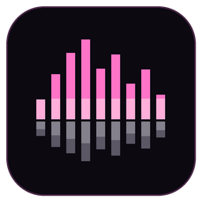
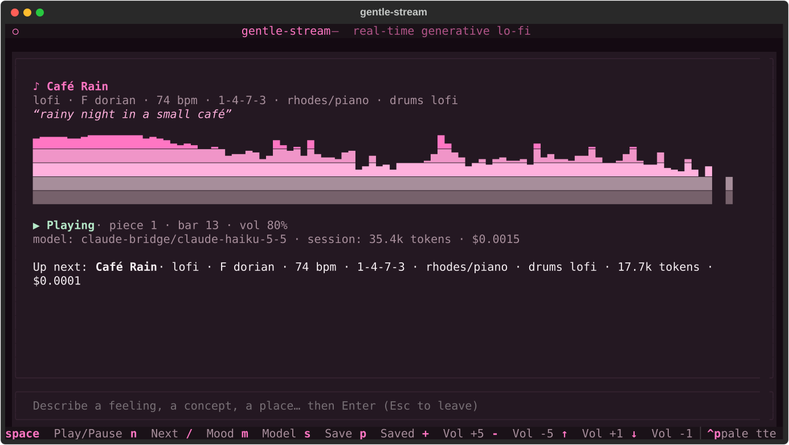
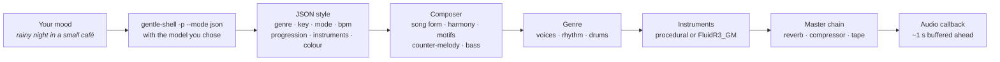

<!-- markdownlint-disable-next-line MD041 -->
<a id="top"></a>

<div align="center">



<h1>gentle-stream</h1>

<p><strong>Endless generative music in your terminal, steered by how you feel.</strong></p>

<p>


<a href="LICENSE"></a>
</p>

<p>
<a href="https://gentlemanprogramming.com/"><strong>Website</strong></a> &bull;
<a href="https://www.youtube.com/@GentlemanProgramming"><strong>YouTube</strong></a> &bull;
<a href="https://github.com/Gentleman-Programming/gentle-stream"><strong>GitHub</strong></a>
</p>

<br/>

<p>
Type <em>"rainy night in a small café"</em> and the music turns into it at the next bar, without stopping.
<a href="https://github.com/Gentleman-Programming/gentle-shell">Gentle Shell</a> reads your mood with the model you
pick, and gentle-stream composes and synthesizes the rest live, bar by bar.
<strong>It never ends, it never repeats exactly, and every note is newly composed.</strong>
</p>




</div>

<div align="center"></div>

## Features

---

### Moods, not settings — Say how it should feel

Describe a feeling, a concept, a place or a scene, in any language. Gentle Shell turns it into musical parameters (genre, key, mode, tempo, progression, instruments, energy, brightness, swing, vinyl, space, melody density) with **the model you choose**. The new style starts at the next bar while the current one keeps playing. A request takes a few seconds; if it fails, the status line says so and the music is untouched.

---

### Real composition — Not a loop

A composer plans every piece with a **song form** (intro → A → B → A' → breakdown → B' → release, then the form loops with fresh variation), cadences that resolve, passing chords, an occasional key lift, a **motif** developed by repetition, sequence, inversion and augmentation, a counter-melody in contrary motion and a bass line that walks into the next chord. Press `n` and you get a new piece with the same mood: new key, progression, melody and groove.

---

### Sixteen genres — Lo-fi by default

Lo-fi, ambient, chiptune, synthwave, jazz, rock/metal, electro-funk, electro house, cumbia, dubstep, hip-hop, trap, chill electronic, lo-fi trap, electro trap and reggaeton. The model picks from the first fifteen genres based on your mood; writing **reggaeton**, **reguetón** or **dembow** routes that genre locally after the same single model interpretation. Every genre shares the composer but has its own rhythm and voices. See [Genres](#genres).

---

### Procedural or sampled — Your choice, no setup required

Every instrument is synthesized out of the box. Run `gentle-stream setup-samples` once and the tonal voices and drums switch to the **FluidR3_GM** soundfont (MIT), rendered note by note with FluidSynth. If anything is missing, it falls back to the procedural instruments. See [Sampled instruments](#sampled-instruments).

---

### Seamless, real-time audio — No clicks, no gaps

The engine renders one bar at a time, with note tails ringing into the next bar, and runs the result through a stateful master chain (vinyl, room, convolution reverb, tape wow, tone, bus compressor, tape saturation), so bars join seamlessly. A producer thread stays about one second ahead; the audio callback only copies samples. Pause, volume and `n` all fade or crossfade.

---

### Saved prompts — Keep what you love

Press `s` to save the audible song to **Saved prompts**, a **new playlist**, or an **existing playlist**. The prompt and musical parameters are stored, so **Playlist** (`p`) brings that sound back without a model call. **My playlist** opens groups, then their songs in the same panel; **Default playlist** remains a read-only built-in list. Choose **Repeat from selection** to play the full list continuously, starting at the highlighted song and wrapping in alphabetical display order. These are generative styles, not recordings. See [Playlist controls](docs/playlist-controls.md).

---

### Token-aware — You see what each mood costs

Only describing a mood calls a model. The status line shows what that call used, and the model line keeps a running total for the session. Everything else costs zero tokens. See [Token usage](#token-usage).

<div align="right"><a href="#top">Back to top</a></div>

<div align="center"></div>

## Get started

**Requirements**

| You need | Why |
| :--- | :--- |
| [uv](https://docs.astral.sh/uv/) | Installs and runs gentle-stream (Python 3.13) |
| [Gentle Shell](https://github.com/Gentleman-Programming/gentle-shell) | `gentle-shell` on your `PATH`, with at least one signed-in model provider; it interprets your moods |
| An audio output device | Playback goes through PortAudio (`sounddevice`); on Linux install your distro's PortAudio package (for example `libportaudio2`) |
| FluidSynth *(optional)* | Only for sampled instruments: `brew install fluid-synth` or your system's `fluidsynth` package |

**Audio libraries:** On Ubuntu/Debian, install `libportaudio2` with your package manager; on macOS, install `portaudio` with Homebrew. These are platform libraries, not Python packages. **Windows can run directly without WSL**, using Python 3.13+ and the default sounddevice output (Windows wheels include PortAudio). See [Native Windows setup](docs/windows-native.md) for PowerShell commands and safe Gentle Shell launcher selection. [Windows/WSL setup](docs/windows-wsl.md) remains an alternative with an optional WSL-to-FFplay output path.

**Install as a command**

```bash
uv tool install 'gentle-stream[samples] @ git+https://github.com/Gentleman-Programming/gentle-stream'
gentle-stream
```

**Or run from a clone**

```bash
git clone https://github.com/Gentleman-Programming/gentle-stream
cd gentle-stream
uv run gentle-stream
```

It starts playing right away. Press `/`, describe a mood, press `Enter`. Press `p` for saved or built-in playlists, `s` to save the audible style and `c` to repeat a playlist from the selected song. Press `F2` to change appearance and open model selection without restarting music; `m` still opens model selection directly. See [Playlist controls](docs/playlist-controls.md) and [Appearance](docs/appearance.md).

**WSL optional Windows output:** select `GENTLE_STREAM_AUDIO_OUTPUT=windows` when
starting a new player to stream live mixed PCM to native Windows FFplay instead
of WSLg/PulseAudio. The current sounddevice output remains the default. See
[Windows/WSL setup](docs/windows-wsl.md#optional-native-windows-audio) for required
Windows Python/FFplay paths, unchanged controls, and unavailable device metrics.

```bash
gentle-stream --mood "rainy night in a small café"        # interpret a mood on start
gentle-stream --model claude-bridge/claude-haiku-5-5      # choose the model up front
gentle-stream setup-samples                               # optional: install FluidSynth first, then add sampled instruments
gentle-stream --help                                      # every flag and key
```

<div align="right"><a href="#top">Back to top</a></div>

<div align="center"></div>

## How it works



| Stage | Module | What happens |
| :--- | :--- | :--- |
| **Mood** | `bridge.py` | Runs `gentle-shell -- -p --mode json --no-session -nt -ns -np -nc --no-mcp --no-themes --no-skill-registry --thinking off [--model …] "<prompt>"`, reads the answer and token usage from the final assistant `message_end` event, and extracts one JSON object |
| **Style** | `style.py` | Validates and clamps every field (`name`, `genre`, `key`, `mode`, `bpm`, `progression`, `chords`, `lead`, `drums`, `energy`, `brightness`, `swing`, `vinyl`, `space`, `lead_density`); anything missing or invalid keeps the current value |
| **Composer** | `composer.py` | Decides **what** plays in each bar: section, energy, chord, key lift, active layers, and the notes of the lead, counter-melody and bass. Pure and deterministic per seed |
| **Genre** | `genres/` | Decides **how** it sounds: voices, chord rhythm (sustained, comped, arpeggiated, strummed…), drum patterns and master settings |
| **Instruments** | `genres/*.py`, `synth.py`, `samples.py` | Procedural oscillators, envelopes and filters, or FluidR3_GM notes rendered offline by FluidSynth and level-matched to the procedural voices |
| **Engine** | `engine.py`, `mastering.py` | Mixes each bar into a buffer whose tails ring into later bars, then applies the stateful master chain: vinyl, room, procedural-IR convolution reverb, tape wow, tone, RMS bus compressor, tape saturation |
| **Player** | `player.py` | A producer thread keeps about one second of audio queued; the audio callback only copies samples, applies a smoothed gain and feeds the spectrum. The screen shows the bar you are **hearing**, not the one being rendered |
| **TUI** | `app.py` | A Textual app in the gentlemanprogramming.com palette (a `gentleman` theme: rose and pink on deep plum) |

Model extensions stay enabled on purpose: some providers (such as `claude-bridge`) are extensions.

<div align="right"><a href="#top">Back to top</a></div>

<div align="center"></div>

## Controls

**F2** or the **gear** opens [Appearance settings](docs/appearance.md): live spectrum
styles, colors, layout and visibility, plus explicit model selection. Preview/Cancel
is temporary; Save persists independently of songs. F2 always works, even when the
controls and footer are hidden. The command palette also includes Settings.

The compact clickable command strip sits between the spectrum panel and mood input.
Tab focuses its buttons; tooltips show full action labels and shortcuts. The model button
shows the chosen model (or Gentle Shell default), with long IDs elided safely. On narrow
terminals, focus/scroll each side group independently. **💾 save, ↻ off/on, ✎ mood, ☷ playlists**
stay left, alongside **Panic**; **⏮ Previous, ⏸ / ▶ play/pause, ⏭ Next** stay centered in the full strip;
**⚙ chosen model, − / + volume** stay right. **⏮** returns to the previous playlist song
in displayed order, wrapping at the first song, with repeat on or off. Pause and volume are
preserved. Select a song in Playlist first; Previous is not a current-song restart and adds
no keyboard shortcut. Older-daemon rejections remain visible without closing the UI.

| Key | Action |
| :--- | :--- |
| `space` | Play / pause; sounddevice fades smoothly, while Windows cuts the owned output to discard buffered audio (a hard cut may click) |
| `n` | Next piece with the same mood, or next song when continuous playback is on |
| `F4` / **Panic** | Hard cut, reopen output and restart the audible current track from the beginning; same musical settings, playlist, pause and volume, no AI call |
| `/` | Describe a mood; `Enter` sends it, `Esc` leaves the input |
| `F2` / gear | Settings: appearance and explicit mood model access; always available |
| `m` | Directly choose the model Gentle Shell uses (listed from `gentle-shell -- --list-models`); `Enter` picks, `Esc` keeps the current one |
| `s` | Save the audible song to Saved prompts, new, or existing playlist; `Enter` saves, `Esc` cancels; replacement is scoped to that group |
| `p` / click **Playlist** | Open **My playlist** groups / **Default playlist**; Left/Right switch tabs, click/Enter opens a group or applies a song; Backspace returns to groups; `d` / `Delete` removes only saved songs; `Esc` closes |
| `c` / **↻ off/on** | Toggle continuous playback from the selected song; in the picker, **Repeat from selection** starts at the highlighted song |
| `+` / `-` | Volume up / down by 5% |
| `↑` / `↓` | Volume up / down by 1% |
| `b` | Back: leave the app and keep the music playing in the background |
| `q` | Quit and stop the music (a running `gentle-shell` call is cancelled) |

**Panic** discards queued audio and DSP tails rather than fading or selecting another song.
It reuses the current track's composition seed and musical settings, preserving instrument mutes
and playlist position even when rendering has looked ahead. F4 works while typing a mood
or when controls are hidden; a pending mood interpretation is cancelled. The cut may click.
Reopen failures appear in the status line and playback is shown as paused; retry Panic, then
resume if needed. Older daemons reject the operation visibly. This is a recovery attempt,
not a guaranteed fix for every cause of stutter, and it does not restart Gentle Shell.

### Flags

| Flag | Meaning |
| :--- | :--- |
| `--model provider/id` | Model Gentle Shell uses to interpret moods (default: Gentle Shell's default) |
| `--mood TEXT` | Mood to interpret as soon as the app starts |
| `--gentle-shell PATH` | `gentle-shell` executable to run (default: `gentle-shell`) |
| `setup-samples` | Subcommand: download the FluidR3_GM soundfont once (see below) |
| `ctl ACTION` | Subcommand: control the music playing in the background (see below) |

<div align="right"><a href="#top">Back to top</a></div>

<div align="center"></div>

## Background playback

The music plays in a background player, one per user, that `gentle-stream` starts on its own. Press `b` to leave the app with the music still playing; run `gentle-stream` again and it attaches to the same music (with `--mood`, the new mood is sent to it). `q` stops the music and the player.

```bash
gentle-stream ctl status   # playback details and audio diagnostics as one JSON line
gentle-stream ctl pause    # also: play, toggle, next
gentle-stream ctl stop     # ends the background player
```

| Command | Output | Exit code |
| :--- | :--- | :--- |
| `ctl status` | One JSON line; just `{"running": false}` when nothing plays | `0` |
| `ctl play`, `pause`, `toggle`, `next`, `stop` | Nothing, or `gentle-stream: nothing is playing` on stderr | `0`, or `1` when nothing plays |

### Audio diagnostics

If audio cuts out, run `gentle-stream ctl status` again and compare the readings:

```json
{"running": true, "playing": true, "name": "Midnight Rain", "genre": "lofi", "mood": "", "underruns": 0, "output_underflows": 0, "buffered_seconds": 1.2}
```

| Field | Interpretation |
| :--- | :--- |
| `underruns` | Callbacks that could not obtain enough samples from the application's rendered-audio queue |
| `output_underflows` | Callbacks reporting a host/PortAudio output underflow, even if the application queue was full or playback was paused |
| `buffered_seconds` | Audio currently queued in the application, in seconds (not the device buffer or total output latency) |

Both counters are cumulative since the current background player (daemon) started; pause, next, Panic and reconnect do not reset them. The queue reading is a changing snapshot, not necessarily the queue depth when a glitch occurred. These metrics help distinguish application starvation from host output trouble, but do **not** prove a root cause or detect every audible artifact. They do not change the sound or buffer settings.

An older running daemon cannot supply these fields: the updated client reports them as JSON `null` (unknown, not zero). They become available after that daemon is stopped and a new one starts. When no player is running, status remains just `{"running": false}`.

On native Windows, the player uses an authenticated JSON named pipe, a current-user-only ACL-protected runtime directory and a Windows file lock; see [Native Windows](docs/windows-native.md#runtime-and-security). On POSIX, the player listens on a Unix socket in a private directory (`$XDG_RUNTIME_DIR/gentle-stream`, default `~/.cache/gentle-stream/run`, mode `0700`), authenticated with a random key in a `0600` file. A player that crashed is detected and replaced on the next start. If the audio output cannot be opened, `gentle-stream` prints the error and exits with `1`.

<div align="right"><a href="#top">Back to top</a></div>

<div align="center"></div>

## Token usage

After each interpretation the status line shows what that call used, and the model line keeps the session total:

```text
Up next: Café Rain · lofi · F dorian · 74 bpm · 1-4-7-3 · rhodes/piano · drums lofi · 17.7k tokens · $0.0001
model: claude-bridge/claude-haiku-5-5 · session: 35.4k tokens · $0.0015
```

| Action | Calls a model? |
| :--- | :--- |
| Describing a mood (`/` or `--mood`) | **Yes** — the only thing that does |
| Playback, `space`, `n`, Panic (`F4`), volume | No |
| Saving (`s`) or applying (`p`) a prompt | No |
| Failed or cancelled requests | Add nothing to the total |

The cost is the one Gentle Shell reports, in US dollars. Providers used through a subscription (such as `claude-bridge`) report `$0.0000`. Opening the model picker runs `gentle-shell -- --list-models`, which lists models without calling one.

<div align="right"><a href="#top">Back to top</a></div>

<div align="center"></div>

## Saved prompts

| | |
| :--- | :--- |
| **Save** | `s`, song name (up to 40 characters), destination (Saved prompts by default, New playlist, or existing named group), `Enter`; New reveals a playlist name field |
| **Apply** | Click **Playlist** or press `p`, choose **My playlist**, open a group, click/Enter a song — starts at the next bar and exits rotation |
| **Built-ins** | Choose **Default playlist** for genre styles without a model call; entries cannot be deleted and browsing/applying them never changes your saved file |
| **Keyboard** | Left/Right switch playlists even while the entry list is focused or empty; Up/Down highlight entries; `Enter` applies, `Esc` closes |
| **Delete** | In **My playlist**, highlight one, `d` or `Delete` |
| **Files** | Legacy `~/.config/gentle-stream/presets.json` stays unchanged; named groups use separate `playlist-library.json` in the same directory (respects `$XDG_CONFIG_HOME`) |
| **Format** | Plain JSON with the prompt and its musical parameters, rewritten atomically |
| **Safety** | An unreadable file is reported and never overwritten; invalid entries are skipped; every value is validated like a model answer, so a hand-edited file still plays |

<div align="right"><a href="#top">Back to top</a></div>

<div align="center"></div>

## Genres

The genre is part of the style: it shows on the details line, survives `n` and is kept by saved prompts (prompts saved before genres existed load as lo-fi). A request that only adjusts the music keeps the current genre.

| Genre | Sound | Typical tempo | With samples |
| :--- | :--- | :--- | :--- |
| `lofi` *(default)* | Felt piano, rhodes, nylon guitar or warm pad, sub bass, dusty swung drums, vinyl crackle, small room, tape wow | 60–92 bpm | FluidR3_GM piano, rhodes, nylon, pad and drums; the sub stays synthesized |
| `ambient` | Slow swelling additive pads, a high FM celesta, sustained sub, starlight air; no drums, a lot of space, clean wide master | 50–80 bpm | Warm Pad, Space Voice, Celesta, Orchestral Harp, piano; sub and air stay synthesized |
| `chiptune` | Four 8-bit channels: pulse lead, fast pulse arpeggios, stepped triangle bass, noise drums; dry and bright | 100–140 bpm | Always procedural (samples do not fit 8-bit) |
| `synthwave` | Detuned saw pads with opening filters, saw/square lead with echo, 16th arpeggiator, pulsing octave bass, gated-reverb snare | 80–118 bpm | Saw Lead, Polysynth, Synth Bass and the Electronic kit, with the gated tail layered on |
| `jazz` | Extended chords, rootless swung comping, walking upright bass, brushes and a spang-a-lang ride, strong swing | 60–140 bpm | Acoustic bass, piano, rhodes, jazz guitar, vibraphone, tenor sax, Jazz and Brush kits |
| `rock` | Double-tracked palm-muted power chords, picked bass, lead guitar, driving drums, crash on every section; `nylon` uses independently plucked procedural strings for clean guitar | 90–140 bpm | Distortion, Overdriven and Clean Guitar, Picked Bass, Strings and the Power kit |
| `electro` | Classic electro-funk: syncopated 808 breakbeats (never four-on-the-floor), funky 16th synth bass, robotic square riffs and arpeggios, cowbell; tight and dry | 100–130 bpm | The real TR-808 kit, Saw/Square Lead, Synth Bass, Synth Strings |
| `electrohouse` | Four-on-the-floor kick, clap on 2 and 4, off-beat open hats, dirty distorted bass riffs, sidechain-pumped supersaws, risers and snare rolls into drops | 124–132 bpm | Electronic kit, Saw Lead, Polysynth; the dirty bass stays synthesized |
| `cumbia` | Guacharaca "ch-chik", tambora and congas, root-fifth bass with pickups, off-beat keyboards, accordion lead (digital-cumbia synth when bright) | 85–110 bpm | Guiro, congas, maracas, cabasa, timbales, Finger Bass, Accordion, Tango Accordion, Drawbar Organ |
| `dubstep` | 140 bpm half-time drums, deep sine sub, LFO wobble bass synced to 1/4–1/16 and triplets, growls, risers and drops | 136–140 bpm | Power and Standard kit drums; sub, wobble, growl and risers stay synthesized |
| `reggaeton` | Original two-bar dembow variants, off-beat chords, short bass pickups and a plucked nylon-guitar colour | 85–110 bpm | Nylon Guitar program and the TR-808 kit; procedural mode plucks synthesized strings |

Explicit **reggaeton**, **reguetón**, **regueton**, **reggaetón** or **dembow** in a mood selects the new style locally after the existing single model call. The extra genre is not added to the model's normal prompt: ordinary moods keep their prompt length and call count. A built-in playlist style needs no model call. This does not guarantee an exact provider price or an acoustic-guitar recording; no live listening comparison has been made.

`rock` covers metal too: with busy drums at energy 0.7 or more it switches to 16th-note chugs and gallops, double kick and china accents.

The four shared tone colours (`piano`, `rhodes`, `nylon`, `pad`) mean something different in each genre (in chiptune they are pulse widths, in rock they are guitars), so the model's answer schema and saved prompts stay the same everywhere.

**Adding a genre** touches one module in [`src/gentle_stream/genres/`](src/gentle_stream/genres/); [`base.py`](src/gentle_stream/genres/base.py) documents the interface, and [`tests/test_genres_contract.py`](tests/test_genres_contract.py) checks every registered genre on both backends.

<div align="right"><a href="#top">Back to top</a></div>

<div align="center"></div>

## Sampled instruments

Optional. Without them every instrument is synthesized and nothing is ever downloaded.

```bash
brew install fluid-synth            # or your system's fluidsynth package
gentle-stream setup-samples         # downloads ~120 MB once; running it again does nothing
```

| | |
| :--- | :--- |
| **What** | The FluidR3_GM General MIDI soundfont, rendered note by note with FluidSynth through `pyfluidsynth` |
| **Source** | Debian's `fluid-soundfont-gm` package: `https://deb.debian.org/debian/pool/main/f/fluid-soundfont/fluid-soundfont-gm_3.1-5.3_all.deb` |
| **Integrity** | Checked against a pinned SHA-256 before extraction; on any failure nothing is left behind |
| **Location** | `~/.cache/gentle-stream/FluidR3_GM.sf2` (or `$XDG_CACHE_HOME/gentle-stream/`), with a `LICENSES.txt` next to it recording source, checksum and license |
| **License** | MIT — Copyright © 2000-2002, 2008 Frank Wen; © 2008 Toby Smithe. Music made with it can be used commercially; keep the MIT notice from `LICENSES.txt` |
| **Binding** | `pyfluidsynth`, the `samples` extra: included by `uv run` in a clone, and by the `[samples]` install above; add it to a clone with `uv sync --extra samples` |
| **Fallback** | If the soundfont, FluidSynth or the binding is missing, the procedural instruments play. The genre's master chain applies to both |

**License policy.** Only assets whose license is verified at the original source, and that allow commercial use of the resulting music, are accepted. The soundfont is never committed to or shipped with this repository. **GeneralUser GS was rejected**: it allows commercial music, but its author states they cannot be 100% sure where all of the samples originated. The reverb uses an impulse response generated by gentle-stream's own code, not a recording.

<div align="right"><a href="#top">Back to top</a></div>

<div align="center"></div>

## Originality

All music is generated: the composer builds every melody, counter-melody, bass line and progression from scratch for each piece. The model is told to **never reproduce existing melodies, songs, riffs or soundtracks**, even when your mood names one; it only captures the general feel (genre, tempo, colour, energy). Model answers are reduced to bounded parameters, so a model cannot inject notes.

<div align="right"><a href="#top">Back to top</a></div>

<div align="center"></div>

## Project layout

| Path | What it holds |
| :--- | :--- |
| [`src/gentle_stream/__init__.py`](src/gentle_stream/__init__.py) | CLI: flags, `setup-samples`, `ctl`, attaching to or starting the background player |
| [`src/gentle_stream/daemon.py`](src/gentle_stream/daemon.py) | The background player process: audio output, private socket, single instance |
| [`src/gentle_stream/client.py`](src/gentle_stream/client.py) | Attach to, start and control the background player (same interface as the in-process player) |
| [`src/gentle_stream/app.py`](src/gentle_stream/app.py) | Textual TUI, theme, spectrum, model picker, save and saved-prompt dialogs |
| [`src/gentle_stream/bridge.py`](src/gentle_stream/bridge.py) | Gentle Shell call, prompt, JSON and token-usage parsing, cancellation |
| [`src/gentle_stream/style.py`](src/gentle_stream/style.py) | The musical parameters and their validation; `n` variations |
| [`src/gentle_stream/composer.py`](src/gentle_stream/composer.py) | Song form, harmony, motif development, counter-melody, bass |
| [`src/gentle_stream/engine.py`](src/gentle_stream/engine.py) | Bar-by-bar rendering and the master chain |
| [`src/gentle_stream/mastering.py`](src/gentle_stream/mastering.py) | Procedural impulse response, convolution reverb, bus compressor, soft clip |
| [`src/gentle_stream/player.py`](src/gentle_stream/player.py) | Real-time playback, buffering, crossfades, spectrum |
| [`src/gentle_stream/samples.py`](src/gentle_stream/samples.py) | Soundfont download and verification, FluidSynth rendering |
| [`src/gentle_stream/synth.py`](src/gentle_stream/synth.py) | Shared oscillators, envelopes, filters, waveshaper |
| [`src/gentle_stream/presets.py`](src/gentle_stream/presets.py) | Saved prompts storage |
| [`src/gentle_stream/genres/`](src/gentle_stream/genres/) | One module per genre plus the registry |
| [`tests/`](tests/) | pytest suite, including TUI tests driven through Textual's test pilot with a fake audio stream |
| [`odd/tasks/`](odd/tasks/) | Feature documents: specs, tasks and evidence for every change |

## Tests

```bash
uv run pytest
```

The default functional suite includes genre shape, finite/level, seam and determinism
checks on every available backend, with no render-speed gate. The suite needs no audio
device and no Gentle Shell: player and TUI tests use a fake output stream and shell.
When the soundfont is installed, player and app tests run on the sampled backend.

The unchanged strict **>10× real-time** eight-bar benchmark is opt-in:

```bash
uv run pytest -m performance tests/test_genres_contract.py
# Existing environment: python -m pytest -m performance tests/test_genres_contract.py
```

Performance depends on hardware and host load; constrained machines may fail this
benchmark without failing audio correctness. Explicit `-m` overrides the default
`not performance` selection. [CI on Linux, macOS, WSL and native Windows](docs/ci.md)
runs functional genre coverage, not this benchmark. Native Windows runs a focused
selection; POSIX jobs run the broader default suite. Configuration is not evidence
of hosted CI success or a real audio-device check.

<div align="right"><a href="#top">Back to top</a></div>

<div align="center"></div>

## Contributing

gentle-stream is built with [Gentle-AI](https://github.com/Gentleman-Programming/gentle-ai) and its **Organic Driven Development (ODD)** workflow:

1. **Open an issue first** describing the behavior you want.
2. **Substantial work gets a feature document** in [`odd/tasks/`](odd/tasks/) with the request, specs, tasks and evidence (see the existing ones for the shape).
3. **Test first**: add a failing behavior test, make it pass, then refactor while `uv run pytest` stays green.
4. **Keep it original and licensed**: no melodies of existing works, and only assets with a verified free license.

<div align="right"><a href="#top">Back to top</a></div>

<div align="center"></div>

## About the author

Built by [Alan Buscaglia](https://github.com/Gentleman-Programming) (Gentleman Programming). The lo-fi sound started as the procedural bed behind the Gentleman Programming YouTube videos; gentle-stream renders it live and lets you steer it.

<div align="center">

<a href="https://gentlemanprogramming.com/"></a>
<a href="https://www.youtube.com/@GentlemanProgramming"></a>
<a href="https://github.com/Gentleman-Programming"></a>

</div>

---

<div align="center">


<br/>

<h3>gentle-stream is crafted with Gentle-AI</h3>

<a href="https://github.com/Gentleman-Programming/gentle-ai">
  
</a>

<br/><br/>

<a href="LICENSE"></a>

</div>
